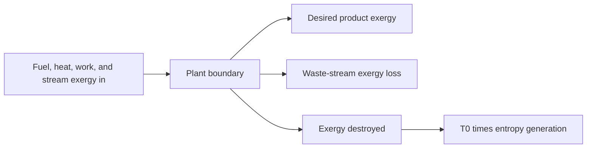

# Exergy and Second-Law Efficiency

Energy measures quantity; exergy measures the part of that energy that can become useful work under stated environmental conditions. A kilogram of hot gas and a kilogram of room-temperature gas may have comparable internal energies, but only the hot gas can drive a heat engine while cooling to the room. A high-pressure stream can drive a turbine while relaxing to atmospheric pressure. Once a system has reached thermal, mechanical, and chemical equilibrium with its surroundings, no further useful work can be extracted from it.

Exergy is therefore relative, not absolute. Every numerical exergy value belongs to an environment defined at least by temperature $T_0$ and pressure $P_0$. Chemical or reacting-system work also requires a reference composition. The equilibrium condition with that environment is called the dead state. Matter at the dead state still contains internal energy; its exergy is zero because that energy can no longer produce work while the surroundings are the only available reservoir.

## Maximum useful work and the dead state

Imagine bringing a closed system reversibly from its initial state to the dead state while allowing heat exchange only with the environment. The system may do work, but some of it merely displaces the atmosphere. The maximum *useful* work excludes the unavoidable displacement work $P_0(V_0-V)$.

For a closed system with negligible kinetic and potential energy, the first law over that process is

$$
U_0-U=Q-W.
$$

If the process is reversible and exchanges heat with the environment at $T_0$, then $Q=T_0(S_0-S)$. Separating total work into useful work and atmospheric displacement work gives

$$
W=W_u+P_0(V_0-V).
$$

Substitution and rearrangement yield the nonflow exergy

$$
\Phi=(U-U_0)+P_0(V-V_0)-T_0(S-S_0).
$$

Per unit mass, including kinetic and potential contributions,

$$
\phi=(u-u_0)+P_0(v-v_0)-T_0(s-s_0)
+\frac{V^2}{2}+gz.
$$

The $P_0(v-v_0)$ term accounts for interaction with the atmosphere. Omitting it treats all boundary work as useful, which overstates recoverable work for a closed system.

A flowing stream already contains the flow work $Pv$ needed to push matter across a control surface. Its physical flow exergy uses enthalpy:

$$
\psi=(h-h_0)-T_0(s-s_0)+\frac{V^2}{2}+gz.
$$

The thermal and mechanical contributions can be combined in several algebraically equivalent ways. Both vanish at $T=T_0$ and $P=P_0$. Kinetic exergy $V^2/2$ and potential exergy $gz$ are already fully convertible to work in the ideal limit, so they do not carry a Carnot factor.

These expressions describe *physical* exergy. A fuel at $T_0$ and $P_0$ still has chemical exergy because its composition is not in equilibrium with the environment. Ordinary turbine, compressor, nozzle, and heat-exchanger exercises often neglect chemical exergy because no reaction occurs and the stream composition stays fixed. Combustors and fuel cells cannot be analyzed that way if the goal is a complete plant exergy balance.

## Why heat has less work potential than work

Shaft work, electrical work, kinetic energy, and potential energy can ideally be converted completely into one another. Heat cannot be converted completely into work while exchanging energy with a single environment. If heat $Q$ crosses a boundary at uniform temperature $T_b$, its exergy transfer is

$$
X_Q=\left(1-\frac{T_0}{T_b}\right)Q.
$$

The factor in parentheses is the Carnot factor. It follows by placing a reversible heat engine between the boundary and the environment: the engine receives $Q$ at $T_b$, rejects $Q_0=Q(T_0/T_b)$, and supplies the difference as work.

For heat transfer over a boundary whose temperature changes, the differential form must be integrated:

$$
X_Q=\int\left(1-\frac{T_0}{T_b}\right)\delta Q.
$$

Heat supplied at $T_b=T_0$ carries zero exergy. Heat supplied above $T_0$ has positive work potential. With a consistent sign convention, heat removed from a refrigerated space below $T_0$ can also represent a desired exergy product, but the signs require care: both $Q$ and the Carnot factor may be negative.

### Worked example: work potential carried by furnace heat

A furnace transfers $100\ \mathrm{kJ}$ to a device at a boundary temperature of $800\ \mathrm{K}$. The environment is at $300\ \mathrm{K}$. The associated exergy is

$$
\begin{aligned}
X_Q
&=\left(1-\frac{T_0}{T_b}\right)Q\\
&=\left(1-\frac{300}{800}\right)(100)\\
&=0.625(100)\\
&=62.5\ \mathrm{kJ}.
\end{aligned}
$$

The remaining $37.5\ \mathrm{kJ}$ is energy that a reversible engine would have to reject to the environment. It is often called anergy. If the same $100\ \mathrm{kJ}$ arrived as shaft work, its exergy would be the full $100\ \mathrm{kJ}$.

### A finite hot body is not a constant-temperature reservoir

The simple Carnot-factor expression assumes that all heat crosses at one boundary temperature. A finite body cools while supplying heat, so its work potential must be integrated. Consider a solid of mass $m$ and constant heat capacity $c$ cooling reversibly from $T_1$ to $T_0$. At an intermediate temperature $T$, the released heat magnitude is $-mc\,dT$. A succession of reversible engines operating between $T$ and $T_0$ produces

$$
dW_{\max}=\left(1-\frac{T_0}{T}\right)(-mc\,dT).
$$

Integrating from $T_1$ down to $T_0$ gives

$$
W_{\max}=mc\left[(T_1-T_0)-T_0\ln\left(\frac{T_1}{T_0}\right)\right].
$$

This equals the decrease in the body's nonflow exergy when thermal expansion is neglected. For a $1.0\ \mathrm{kg}$ metal block with $c=0.50\ \mathrm{kJ/(kg\,K)}$, initially at $500\ \mathrm{K}$ in a $300\ \mathrm{K}$ environment,

$$
\begin{aligned}
W_{\max}
&=(1)(0.50)\left[200-300\ln(500/300)\right]\\
&=0.50(46.75)\\
&=23.4\ \mathrm{kJ}.
\end{aligned}
$$

The block releases $mc(T_1-T_0)=100\ \mathrm{kJ}$ of energy, yet only $23.4\ \mathrm{kJ}$ is ideally convertible to work. Multiplying the entire $100\ \mathrm{kJ}$ by a Carnot factor evaluated at $500\ \mathrm{K}$ would give $40\ \mathrm{kJ}$ and overstate the result because the block does not remain at $500\ \mathrm{K}$.

## Exergy balances and destroyed work potential

For a closed system, the exergy balance can be written

$$
X_2-X_1
=\sum_k\int\left(1-\frac{T_0}{T_{b,k}}\right)\delta Q_k
-W_u-X_{\mathrm{dest}},
$$

where $W_u$ is useful work done by the system. For a control volume, the rate form is

$$
\begin{aligned}
\frac{dX_{\mathrm{CV}}}{dt}
={}&\sum_k\left(1-\frac{T_0}{T_{b,k}}\right)\dot Q_k
-\dot W_u\\
&+\sum_{\mathrm{in}}\dot m\psi
-\sum_{\mathrm{out}}\dot m\psi
-\dot X_{\mathrm{dest}}.
\end{aligned}
$$

The balance uses the same boundary, mass flows, and sign convention as the energy balance. At steady state the storage term is zero. Exergy can cross with heat, work, and mass; unlike energy, it can be destroyed inside the control volume.

The Gouy–Stodola theorem relates destroyed exergy to entropy generation:

$$
X_{\mathrm{dest}}=T_0S_{\mathrm{gen}},
\qquad
\dot X_{\mathrm{dest}}=T_0\dot S_{\mathrm{gen}}.
$$

One route to the theorem is to subtract $T_0$ times the entropy balance from the energy balance and collect the state terms into exergy. The remaining nonnegative term is $T_0S_{\mathrm{gen}}$. It puts irreversibility into work units and permits direct comparison among components.

Exergy destruction and exergy loss are different. Destruction occurs inside a boundary because entropy is generated. Loss is exergy carried across the boundary without being used, such as a hot exhaust discharged to the atmosphere. Enlarging the boundary to include an exhaust heat-recovery unit may convert part of that former loss into a product; it does not undo destruction that already occurred in a combustor or turbine.

### Worked example: lost work in an irreversible compressor

A compressor generates entropy at $0.12\ \mathrm{kW/K}$ in an environment at $T_0=298\ \mathrm{K}$. Its destroyed exergy rate is

$$
\begin{aligned}
\dot X_{\mathrm{dest}}
&=T_0\dot S_{\mathrm{gen}}\\
&=(298\ \mathrm{K})(0.12\ \mathrm{kW/K})\\
&=35.8\ \mathrm{kW}.
\end{aligned}
$$

For the same specified inlet state, outlet state constraints, and heat interactions, a reversible compressor would require $35.8\ \mathrm{kW}$ less useful power. If the reversible comparison is assigned different outlet cooling or a different final state, that interpretation no longer follows; reversible work must refer to the same task.

## Calculating physical flow exergy of an ideal gas

For an ideal gas with constant specific heat and negligible kinetic and potential energy, substitute

$$
h-h_0=c_p(T-T_0)
$$

and

$$
s-s_0=c_p\ln\left(\frac{T}{T_0}\right)
-R\ln\left(\frac{P}{P_0}\right)
$$

into the flow-exergy definition. The result is

$$
\psi=c_p\left[(T-T_0)-T_0\ln\left(\frac{T}{T_0}\right)\right]
+RT_0\ln\left(\frac{P}{P_0}\right).
$$

The first bracket is the thermal contribution and vanishes at $T=T_0$. The pressure term is the mechanical contribution and vanishes at $P=P_0$. For states allowed by the model, their sum is nonnegative relative to the dead state.

### Worked example: hot, pressurized air

Air is at $T=600\ \mathrm{K}$ and $P=500\ \mathrm{kPa}$ in an environment at $T_0=300\ \mathrm{K}$ and $P_0=100\ \mathrm{kPa}$. Use $c_p=1.005\ \mathrm{kJ/(kg\,K)}$ and $R=0.287\ \mathrm{kJ/(kg\,K)}$.

The thermal contribution is

$$
\begin{aligned}
\psi_T
&=1.005\left[(600-300)-300\ln(600/300)\right]\\
&=1.005[300-207.94]\\
&=92.52\ \mathrm{kJ/kg}.
\end{aligned}
$$

The mechanical contribution is

$$
\begin{aligned}
\psi_P
&=(0.287)(300)\ln(500/100)\\
&=86.1\ln 5\\
&=138.58\ \mathrm{kJ/kg}.
\end{aligned}
$$

Therefore

$$
\psi=92.52+138.58=231.10\ \mathrm{kJ/kg}.
$$

Cooling the air reversibly to $300\ \mathrm{K}$ at high pressure would recover the thermal part; expanding it reversibly to $100\ \mathrm{kPa}$ would recover the mechanical part. An actual device obtains less because it generates entropy.

## Second-law efficiency depends on the product

A general exergetic efficiency is

$$
\eta_{II}=\frac{\text{desired exergy product}}
{\text{exergy expended to obtain it}}.
$$

The numerator and denominator must match the component's purpose. There is no single formula that can be copied to every device.

| Device or process | Desired product | Exergy supplied or consumed | Common form |
|---|---|---|---|
| Adiabatic turbine | shaft work | decrease in stream exergy | $\eta_{II}=w_{\mathrm{actual}}/w_{\mathrm{rev}}$ |
| Adiabatic compressor | increase in stream exergy | shaft work | $\eta_{II}=w_{\mathrm{rev}}/w_{\mathrm{actual}}$ |
| Electric resistance heater | exergy gained by heated body | electrical work | $\eta_{II}=\Delta X/W_{\mathrm{elec}}$ |
| Heat exchanger | exergy gained by cold stream | exergy lost by hot stream | $\eta_{II}=\Delta X_c/(-\Delta X_h)$ |
| Refrigerator | exergy of cooling load | work input | $\eta_{II}=\mathrm{COP}/\mathrm{COP}_{\mathrm{rev}}$ |

An ordinary electric heater can have a first-law efficiency near one because almost all electrical work becomes heat. Its second-law efficiency may be low when it supplies heat only slightly above room temperature: high-grade electrical exergy is degraded to low-temperature thermal energy. A boiler can show a respectable energy efficiency while destroying substantial exergy during combustion and finite-temperature heat transfer.

### Worked example: turbine exergetic efficiency

An adiabatic turbine receives a stream whose physical exergy decreases by $500\ \mathrm{kJ/kg}$ between inlet and specified exit conditions. It produces $430\ \mathrm{kJ/kg}$ of shaft work. With no other exergy transfers, the balance gives

$$
x_{\mathrm{dest}}=500-430=70\ \mathrm{kJ/kg}.
$$

The second-law efficiency is

$$
\eta_{II}=\frac{430}{500}=0.86.
$$

If $T_0=300\ \mathrm{K}$, the associated specific entropy generation is

$$
s_{\mathrm{gen}}=\frac{x_{\mathrm{dest}}}{T_0}
=\frac{70}{300}
=0.233\ \mathrm{kJ/(kg\,K)}.
$$

The missing $70\ \mathrm{kJ/kg}$ has not vanished as energy. It remains in the outlet energy and surroundings but has lost the capacity to appear as useful work for the stated environment.

## Reading an exergy-destruction map

An exergy balance becomes diagnostic when the enclosing plant is divided into components. Each control volume receives a destruction term $T_0\dot S_{\mathrm{gen}}$. Internal exergy transfers between adjacent components cancel when their balances are added, while destruction terms add. The plant total is therefore consistent with the component totals as long as every analyst uses the same environment and defines the boundaries without gaps or overlaps.

A large destruction rate identifies a thermodynamic opportunity, not an automatic design change. Combustion often produces substantial entropy because chemical reaction and heat transfer occur far from equilibrium. Reducing that destruction may demand different chemistry, staged reaction, preheating, or a fuel-cell route, all with cost and materials consequences. A condenser may reject a huge energy rate but destroy less exergy per unit heat because the transfer occurs near the environmental temperature. Ranking components by energy loss alone can therefore point attention at the wrong equipment.

Throttling provides a clean contrast between energy and exergy. In a steady adiabatic valve with negligible kinetic and potential changes,

$$
h_2=h_1.
$$

No enthalpy is lost and no work is produced, yet pressure falls and entropy rises. The flow-exergy change is

$$
\psi_2-\psi_1
=(h_2-h_1)-T_0(s_2-s_1)
=-T_0(s_2-s_1),
$$

so the decrease is exactly the exergy destroyed. Replacing a valve with a suitable expander can recover part of that pressure exergy, although phase behavior, flow rate, reliability, and cost determine whether recovery is sensible.

Heat exchangers need careful product definitions. For an adiabatic two-stream exchanger, the hot stream's exergy decrease supplies both the cold stream's exergy increase and the destruction caused by finite temperature differences and pressure drops:

$$
-\Delta\dot X_h
=\Delta\dot X_c+\dot X_{\mathrm{dest}}.
$$

The ratio $\Delta\dot X_c/(-\Delta\dot X_h)$ is useful when heating the cold stream is the intended service. If both outlet streams are valuable process feeds, a single product-to-fuel ratio may conceal the actual design objective. Reporting the destruction rate alongside outlet constraints is then clearer than forcing every exchanger into one efficiency formula.

The same caution applies at plant scale. A cogeneration plant has both electrical work and useful process heat as products; discarding the heat product from the numerator understates performance. Conversely, counting any warm discharge as useful heat overstates it unless a real demand exists at the required temperature. Exergy gives commensurate units, but the analyst must still specify what the installation is meant to produce.

## Reference choices and consistency checks

- Always report $T_0$ and $P_0$ with an exergy result. Changing the environment changes physical exergy and the Carnot factor, even when the system state remains fixed.
- Apply one reference convention to every inlet and outlet. Absolute tabulated enthalpies and entropies may use arbitrary datum values; consistent differences remove those datums from physical-exergy changes.
- Do not set the environment equal to each stream's local surroundings merely to simplify a calculation. A plant comparison needs one common dead state.
- Exergy destruction must be nonnegative. A negative value usually comes from inconsistent heat signs, omitted mass streams, or mixing useful work with total boundary work.
- A component can have no heat loss and still destroy exergy. Adiabatic friction, mixing, throttling, shocks, and pressure drops all generate entropy.
- First-law and second-law efficiencies answer different questions. The former tracks energy conversion; the latter compares work potential used with work potential supplied.

See also: [entropy and entropy balance](/physics/thermodynamics/entropy-and-entropy-balance) · [second-law heat engines and refrigerators](/physics/thermodynamics/second-law-heat-engines-and-refrigerators) · [gas power cycles](/physics/thermodynamics/gas-power-cycles) · [vapor and combined power cycles](/physics/thermodynamics/vapor-and-combined-power-cycles) · [chemical reactions and combustion](/physics/thermodynamics/chemical-reactions-and-combustion)

